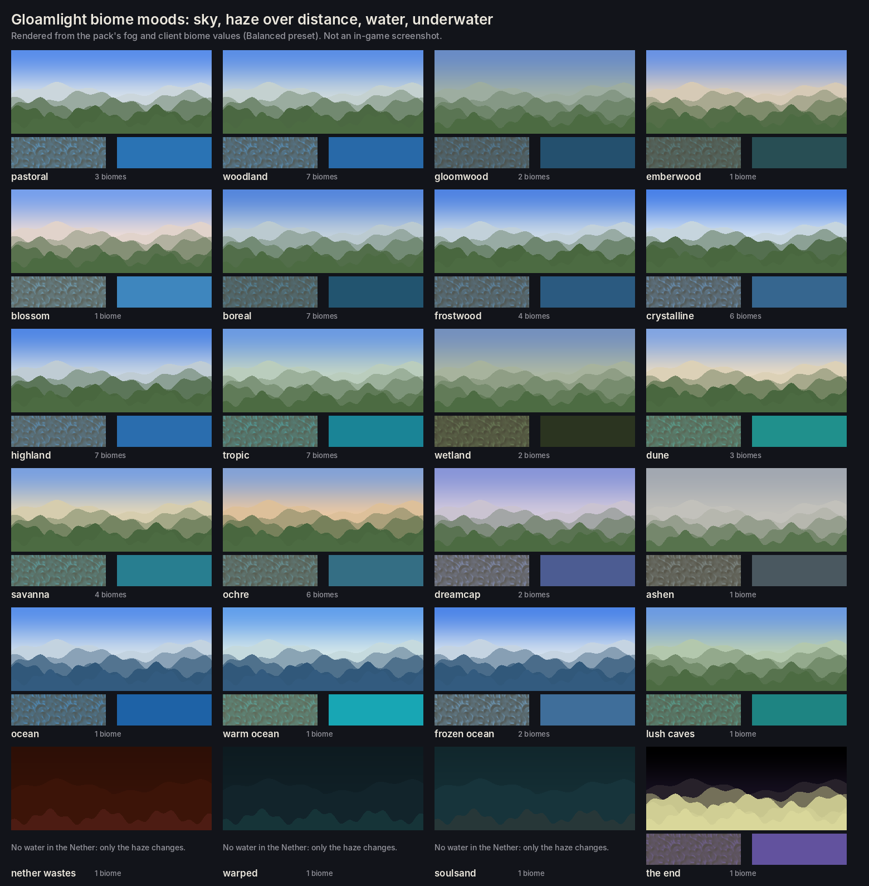
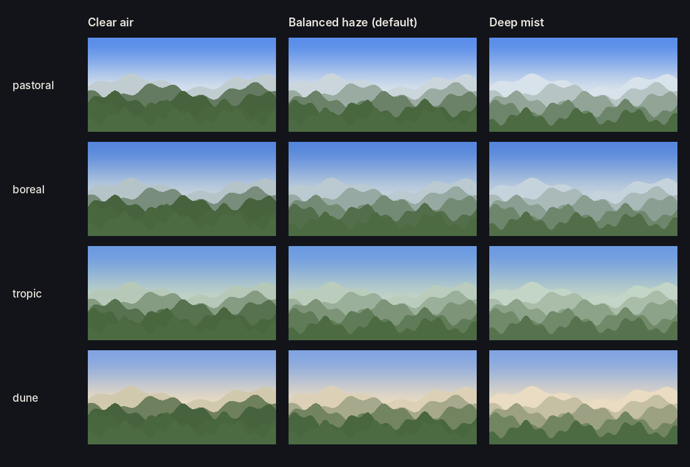
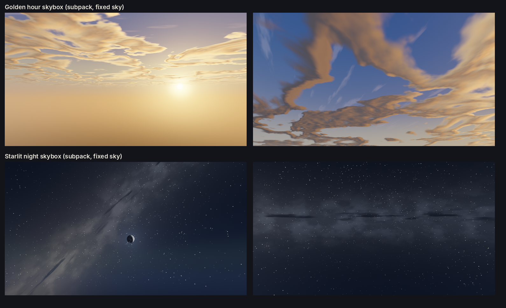
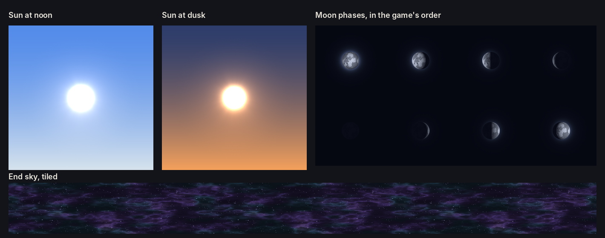
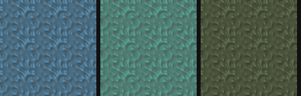
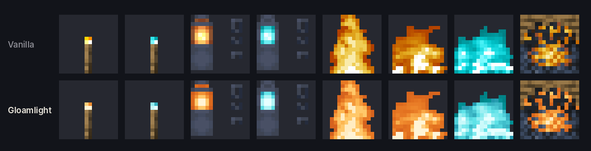

# Gloamlight

A resource pack for **Minecraft: Bedrock Edition 26.60 or newer** that brings back the depth, haze and glow of the old MCPE shader era using only what standard **Fancy** graphics can draw. No shaders, no patched client, no material files, no Vibrant Visuals, no ray tracing.

> The name comes from *gloaming*, the dusk light old MCPE shaders were loved for. The pack's one rule: **warm light, cool air.**



*Every image on this page is rendered by the build tools from the pack's own files. None of them are in-game screenshots.*

## Install

1. Download [`dist/Gloamlight_1.0.0.mcpack`](dist/Gloamlight_1.0.0.mcpack) and open it. Minecraft imports it.
2. Turn it on under **Settings > Global Resources** (or a world's **Resource Packs**). Put it above any other pack that changes skies, fog, water or biome colours.
3. Keep **Beautiful Skies** on (the sun and moon need it) and **Render Clouds** on.
4. Graphics mode: **Fancy**. You don't have to switch: Gloamlight ships no PBR assets, so while it is active the game caps graphics at Fancy and Vibrant Visuals stays off. That is deliberate.
5. Optional: press the gear icon next to the pack to pick a preset on the slider and to tune the glow.

The haze scales with your render distance, so it looks the same at 12 chunks or 32. On the Galaxy S26 Ultra, 16 to 24 chunks is the sweet spot.

## What it changes, and what it leaves alone

Gloamlight touches only the systems that make the atmosphere. Every other block, item, mob, UI screen and sound stays vanilla.

| Area | What changes |
| --- | --- |
| Sky | Zenith colour for every Overworld biome, matched to its haze, so the gradient from zenith to horizon has depth |
| Haze and fog | A distance haze for all 89 vanilla biomes, plus rain and snow fog and underwater fog, with three strength presets |
| Sun and moon | 1024 px sun with a bloom the game itself brightens at sunrise and sunset; 2048 x 1024 moon phases with craters, maria, earthshine and a cool halo |
| Clouds | Cumulus fields with clear gaps and wind-stretched streets instead of uniform speckle |
| Weather | Soft, thin rain streaks and snowflakes in three shapes, at 4x resolution |
| Water | Animated still water (64 frames, 64 px), flowing water (48 frames, 128 px) and cauldron water with waves, sun glints and a moving caustic web; colour and clarity per biome; underwater fog that clears as your eyes adjust |
| Foliage | One colour grade for all seven grass and leaf colormaps: no neon lime, no sallow yellow |
| Light sources | Hotter flame colours on torches, lanterns, campfires and fire, including soul and copper variants (pixel art and sizes untouched) |
| Glow | A soft additive halo around torch, soul torch and candle flames, and on vanilla's green flame particle (most likely the copper torch's); fireflies become glowing motes |
| The End | A seamless 1024 px nebula sky |
| Optional | Two fixed 360 degree skyboxes (golden hour and starlit night) for builds and screenshots |

Not changed: block textures outside the list above, block models, mobs, items, UI, sounds, terrain generation and gameplay. No behaviour pack, no scripts.

## How it works in Fancy graphics

Everything below was checked against Mojang's official 26.60 vanilla pack and JSON schemas, Microsoft's creator documentation, the Bedrock Wiki, and the community's reverse-engineered RenderDragon shaders before any file was written.

**Sky.** In Fancy the sky is a gradient from a *sky colour* at the zenith to the *fog colour* at the horizon. The engine fades both toward black at night, toward grey in rain, and adds the sunrise tint itself. So Gloamlight sets the zenith per biome (`minecraft:sky_color` in each client biome file) and the horizon through the haze colour. Distant terrain fades into exactly that horizon colour, which is where the seamless horizon and the depth come from.

**Why the default keeps the live sky.** Fancy draws the Overworld cubemap (`textures/environment/overworld_cubemap/`) as a plain picture. The vanilla `LegacyCubemap` shader samples the texture with no time-of-day input, so a painted sky never darkens at night and never changes at dusk; skybox pack users also report that it covers the moving sun and moon. A painted default would freeze the day. The two skyboxes are therefore opt-in presets, meant for a locked time of day.

**Haze and fog.** Vanilla fog definitions live in the reserved `minecraft` namespace, which resource packs cannot replace. Each biome gets its own `gloamlight:fog_<biome>` definition (air, rain and underwater), and the pack overrides that biome's client biome file to point at it. Ambient sounds, music, precipitation and Vibrant Visuals identifiers from the vanilla file are carried over untouched.

**Sun and moon.** Both are single quads whose texture is multiplied by a time-of-day colour and *added* to the sky, so black is invisible. That lets the texture carry a bloom, which the engine brightens near the horizon. Every quad fades to pure black before its edge, so the square never shows.

**Water.** The game multiplies grey flipbooks by each biome's water colour and opacity, so the textures carry light and motion, not colour. They are built from waves whose wave numbers and speeds are whole numbers, so every frame tiles and the loop is seamless. The caustic web comes from pushing a fine grid of light rays through the waves and counting where they land. The engine also makes water more opaque with distance, which gives a natural, Fresnel-like effect: far water shows the bright, sky-like texture while near water stays clear.

**Glow.** Fancy has no bloom, but particles can blend additively. Each vanilla flame particle gets one extra event that places a soft additive glow sprite where the flame appears, so lights get a halo that flickers with them. The glow strength comes from the pack settings through Molang (`query.get_pack_setting`).

**Clouds.** Fancy clouds are 3D cells built from `clouds.png`, coloured by the game (white by day, orange at sunrise and sunset, grey in rain). The texture keeps vanilla's 256 px size so the size of each cell in the world stays exactly as Mojang tuned it; only the pattern changes.

## Art direction

Gloamlight is built on one contrast: **warm light, cool air.** Old MCPE shaders felt deep because warm sunlight and torchlight sat against cool, hazy distance. Gloamlight rebuilds that contrast with the tools Fancy really draws.

- **Light is amber.** Sun, fire, torches and lanterns run from deep ember through amber and gold to a white-hot core, and they bloom.
- **Air is cool and biome-tinted.** Near things stay saturated; distance melts into each biome's own haze. Humid biomes close in, cold and dry ones stay crystal clear.
- **Shadows and night are cool.** Slate and deep blue, so warm lights pop at night.
- **Water is liquid sky.** Dark troughs, bright crests, a caustic web. Clarity follows climate: glass-clear warm seas, steel-blue cold water, peat-brown swamps.
- **Palette discipline.** Greens move from neon lime toward emerald and golden olive. Pure white is reserved for the sun's core, wave glints and snow.

**Dawn to midnight.** At dawn the sun rises inside a wide gold bloom and the low haze holds the cool night air. Noon has a deep zenith over a pale, bright horizon and a small, crisp sun. At golden hour the game brightens the sun's glow and warms the horizon on the sun's side, and the clouds turn orange. Night falls to slate, the moon wears a cool halo, and torches, candles, lanterns and fireflies become the warm focal points.

**Biome moods.** Every vanilla biome belongs to one of 41 moods. Clarity is where the haze starts and ends, as a share of your render distance (blocks in the Nether).

<details>
<summary>The full mood table</summary>

| Mood | Biomes | Zenith | Haze | Clarity | Water, opacity | Underwater, visibility |
| --- | --- | --- | --- | --- | --- | --- |
| pastoral | plains, sunflower_plains, meadow | `#5A8EEA` | `#D8E2EB` | 40% to 100% | `#44A0EC` 0.6 | `#2A73B4` 64 |
| woodland | forest, forest_hills, flower_forest, birch_forest, birch_forest_hills, birch_forest_mutated, birch_forest_hills_mutated | `#5C8FE6` | `#CFDBDD` | 34% to 100% | `#3E96E2` 0.62 | `#2869A8` 60 |
| gloomwood | roofed_forest, roofed_forest_mutated | `#6A8CC6` | `#A4B3A7` | 20% to 100% | `#3C78A8` 0.68 | `#24506E` 48 |
| emberwood | dappled_forest | `#6A93E4` | `#E2D3C0` | 30% to 100% | `#427884` 0.66 | `#284E54` 46 |
| blossom | cherry_grove | `#77A0EC` | `#EEDDD7` | 28% to 100% | `#5FB2E8` 0.55 | `#3E86BE` 64 |
| boreal | taiga, taiga_hills, taiga_mutated, mega_taiga, mega_taiga_hills, redwood_taiga_mutated, redwood_taiga_hills_mutated | `#5687DD` | `#C5D3DC` | 30% to 100% | `#3A84B2` 0.64 | `#22546F` 52 |
| frostwood | cold_taiga, cold_taiga_hills, cold_taiga_mutated, grove | `#5084E2` | `#CEDCE8` | 36% to 100% | `#4A88BE` 0.66 | `#2B5A80` 50 |
| crystalline | ice_plains, ice_plains_spikes, ice_mountains, snowy_slopes, frozen_peaks, jagged_peaks | `#4A82E8` | `#D5E3F1` | 50% to 100% | `#5A94D0` 0.68 | `#36668F` 48 |
| highland | extreme_hills, extreme_hills_edge, extreme_hills_mutated, extreme_hills_plus_trees, extreme_hills_plus_trees_mutated, stony_peaks, stone_beach | `#5288E4` | `#CCD8E4` | 46% to 100% | `#3F98E6` 0.56 | `#2A6DAE` 64 |
| tropic | jungle, jungle_hills, jungle_mutated, jungle_edge, jungle_edge_mutated, bamboo_jungle, bamboo_jungle_hills | `#6C9BE2` | `#C3D5C6` | 20% to 100% | `#2AB4C6` 0.52 | `#1A8496` 64 |
| wetland | swampland, swampland_mutated | `#7591BE` | `#AEB9A4` | 14% to 100% | `#5E7350` 0.8 | `#2B3420` 20 |
| mangrove | mangrove_swamp | `#7496C0` | `#B2BEA9` | 14% to 100% | `#537560` 0.8 | `#2E4434` 22 |
| dune | desert, desert_hills, desert_mutated | `#82A5E2` | `#EADCC3` | 38% to 100% | `#34BCB4` 0.5 | `#20908C` 72 |
| savanna | savanna, savanna_mutated, savanna_plateau, savanna_plateau_mutated | `#7BA1E0` | `#E3D7B9` | 36% to 100% | `#3FB0C6` 0.54 | `#287E90` 64 |
| ochre | mesa, mesa_bryce, mesa_plateau, mesa_plateau_mutated, mesa_plateau_stone, mesa_plateau_stone_mutated | `#84A2D6` | `#EBC9A3` | 36% to 100% | `#529EB6` 0.58 | `#346E84` 56 |
| dreamcap | mushroom_island, mushroom_island_shore | `#8996D8` | `#D4CBDD` | 26% to 100% | `#7A90D4` 0.6 | `#4C5C92` 52 |
| ashen | pale_garden | `#A2A8B1` | `#C2C1BB` | 8% to 82% | `#78898F` 0.7 | `#4A5860` 40 |
| river | river | `#5B8FE9` | `#D5E0E9` | 36% to 100% | `#3C9AE2` 0.58 | `#2870AE` 56 |
| frozen river | frozen_river | `#4E85E6` | `#D3E1EE` | 42% to 100% | `#6098CC` 0.7 | `#3E6A94` 44 |
| beach | beach | `#5F96EA` | `#E2E4DD` | 42% to 100% | `#42A4E6` 0.56 | `#2B78B6` 64 |
| cold beach | cold_beach | `#5087E6` | `#D6E2EE` | 46% to 100% | `#5090CC` 0.66 | `#335F8E` 50 |
| ocean | ocean | `#5990EA` | `#D2E0EC` | 42% to 100% | `#3290E0` 0.64 | `#1E62A6` 64 |
| deep ocean | deep_ocean | `#5990EA` | `#CEDDEA` | 40% to 100% | `#2C80D2` 0.7 | `#194F8C` 52 |
| warm ocean | warm_ocean | `#63A0EC` | `#D5E8EA` | 44% to 100% | `#30D2DC` 0.42 | `#18A6B4` 96 |
| deep warm ocean | deep_warm_ocean | `#63A0EC` | `#D3E6EA` | 42% to 100% | `#2BC0D6` 0.52 | `#1690A8` 84 |
| lukewarm ocean | lukewarm_ocean | `#5F99EB` | `#D3E4EC` | 43% to 100% | `#2EB6E6` 0.5 | `#1A86B6` 80 |
| deep lukewarm ocean | deep_lukewarm_ocean | `#5F99EB` | `#D1E2EB` | 41% to 100% | `#29A4DA` 0.58 | `#1772A6` 68 |
| cold ocean | cold_ocean | `#5288E4` | `#C9D7E5` | 42% to 100% | `#3A80C6` 0.68 | `#255A92` 56 |
| deep cold ocean | deep_cold_ocean | `#5288E4` | `#C7D5E3` | 40% to 100% | `#3272B8` 0.74 | `#1E4C80` 48 |
| frozen ocean | frozen_ocean, legacy_frozen_ocean | `#4E86E8` | `#D5E2EF` | 46% to 100% | `#629CCC` 0.72 | `#3F6E9A` 44 |
| deep frozen ocean | deep_frozen_ocean | `#4E86E8` | `#D3E0EE` | 44% to 100% | `#568EC2` 0.76 | `#335F8C` 40 |
| lush caves | lush_caves | `#6C9BE2` | `#BCD0B6` | 26% to 100% | `#34B8B0` 0.52 | `#1E8482` 60 |
| dripstone | dripstone_caves | `#6F90C8` | `#BCA893` | 28% to 100% | `#448EB6` 0.62 | `#2A5E7E` 50 |
| deep dark | deep_dark | `#2E3F60` | `#0F131B` | 0% to 55% | `#2F5676` 0.72 | `#142434` 32 |
| sulfur | sulfur_caves | `#8BA2C6` | `#C8C38C` | 16% to 90% | `#44C496` 0.62 | `#1F5E44` 40 |
| nether wastes | hell | none | `#3C1408` | 8 to 88 blocks | vanilla | vanilla |
| crimson | crimson_forest | none | `#3B0A09` | 8 to 84 blocks | vanilla | vanilla |
| warped | warped_forest | none | `#12242B` | 8 to 84 blocks | vanilla | vanilla |
| soulsand | soulsand_valley | none | `#17343B` | 6 to 80 blocks | vanilla | vanilla |
| basalt | basalt_deltas | none | `#5B5551` | 4 to 72 blocks | vanilla | vanilla |
| the end | the_end | `#000000` | `#150F1F` | 55% to 100% | vanilla | vanilla |

</details>

## Presets and settings

Press the gear icon next to the pack. The **subpack slider** picks a look; the **settings** tune the glow.

| Preset | What it does |
| --- | --- |
| Clear air | Haze starts much later. For long views and building. |
| **Balanced haze** (default) | The intended look. |
| Deep mist | Haze starts close. Moody, shader-era fog. |
| Golden hour skybox (fixed sky) | A painted 360 degree dusk sky with a low sun and lit clouds. |
| Starlit night skybox (fixed sky) | A painted night sky with the Milky Way and a crescent moon. |



The two skyboxes never change with the time of day (Fancy draws any skybox as a fixed picture), so lock the time to match: `/gamerule doDaylightCycle false`, then `/time set 12500` for golden hour or `/time set 18000` for night.



| Setting | Range | Effect |
| --- | --- | --- |
| Glow around torch and candle flames | 0 to 2 (default 1) | Strength of the halo. 0 turns it off. |
| Glowing fireflies | on or off (default on) | Fireflies as glowing motes, or vanilla's tiny dots. |

## The pieces





*Still water in plains, warm ocean and swamp: the same flipbook, tinted and faded by each biome.*



## Built for the Galaxy S26 Ultra

The S26 Ultra runs a Snapdragon 8 Elite Gen 5 for Galaxy with an Adreno 840 GPU, 12 to 16 GB of RAM and a 6.9 inch 3120 x 1440 display at 120 Hz. Gloamlight spends that headroom where it shows: a 1024 px sun, 512 px per moon phase, a 1024 px End sky, 64-frame frame-blended water at four times vanilla's resolution, and 2048 px skybox faces in the optional presets. Torch textures stay 16 x 16 on purpose, because Bedrock does not scale torch textures above that.

## Compatibility

- Another pack that changes client biomes, fogs, water, skies or the same textures will conflict; the pack higher in the list wins, file by file.
- Biomes added by other add-ons keep their own settings.
- Vibrant Visuals and ray tracing need PBR packs; Gloamlight keeps the game in Fancy by design.
- Minecraft versions before 26.60 are not supported (the manifest asks for 26.60).

## First run checklist

Things worth looking at on your first evening with the pack:

1. A sunrise or sunset over open water: the sun's bloom, the warm horizon, orange clouds.
2. Haze on far mountains, compared across the three presets.
3. Water in plains, a warm ocean and a swamp, from above and from below (diving in, the view clears over a few seconds).
4. Night with torches and candles, then the glow slider at 0, 1 and 2.
5. A firefly bush at night.
6. Rain, and snow in a cold biome.
7. The Nether's five biomes and the End sky.

If something looks wrong, a screenshot plus the biome name and time of day is all I need to tune it.

## Building from source

Every texture and JSON file in `pack/` is generated by `tools/`. To rebuild:

```sh
pip install numpy pillow jsonschema
git clone https://github.com/Mojang/bedrock-samples ../mojang/bedrock-samples   # or set BEDROCK_SAMPLES
python tools/build.py          # everything (the skyboxes take a few minutes)
python tools/build.py water    # one step
python tools/previews.py       # the images on this page
```

`tools/build.py validate` runs before packaging. It checks every client biome, particle and the manifest against Mojang's official 26.60 JSON schemas; refuses manifest members the game would reject; checks every replaced texture against a real vanilla path, every flipbook against an existing atlas tile, every biome's fog reference, the sun and moon edges, and that player-facing text has no punctuation dashes.

| Folder | Contents |
| --- | --- |
| `pack/` | The resource pack |
| `pack/subpacks/` | Haze presets and the two skyboxes |
| `tools/gl/palette.py` | The art direction as data: moods, colours, distances |
| `tools/` | Generators, validator, packager, previews |
| `dist/` | The packaged `.mcpack` |
| `docs/` | Images for this page |

## Credits

- Torch, lantern, campfire and fire textures and the grass and leaf colormaps are recoloured from Mojang's vanilla textures ([Mojang/bedrock-samples](https://github.com/Mojang/bedrock-samples)). Every other texture is generated from scratch by the tools in this branch.
- Not an official Minecraft product. Not approved by or associated with Mojang or Microsoft.
