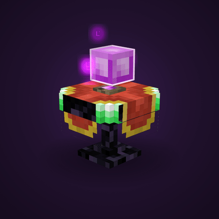
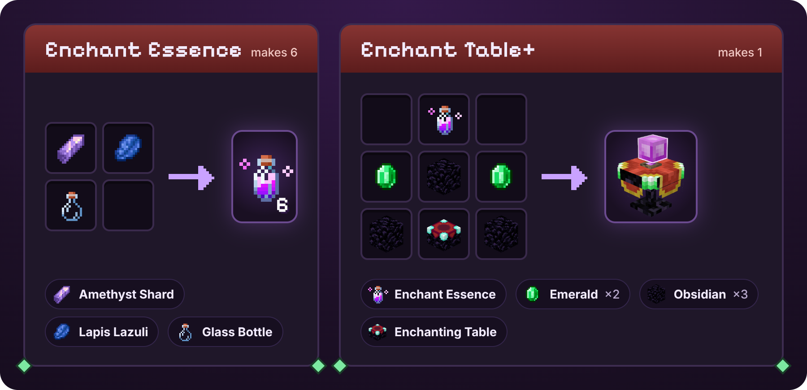
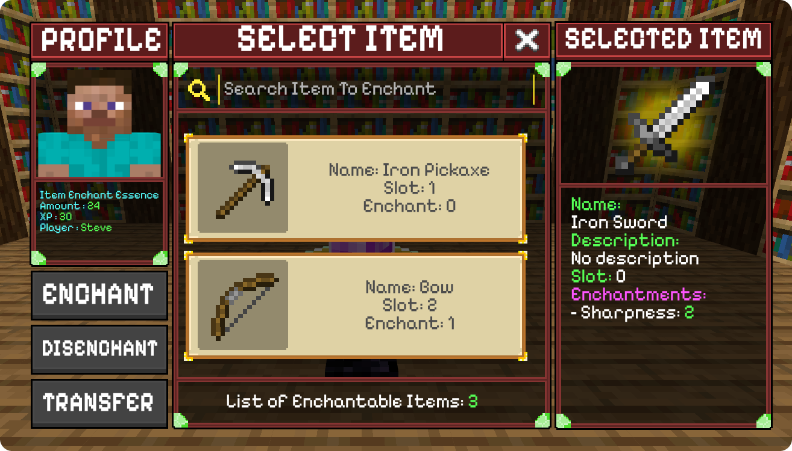
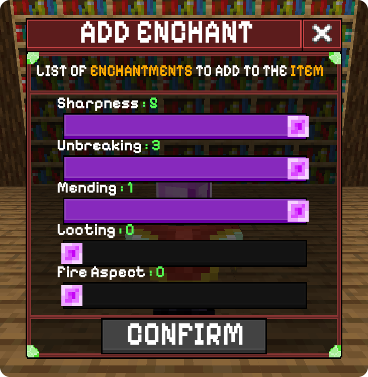
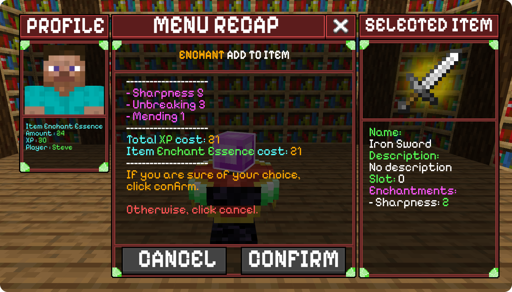

# Enchant+ 1.1.0

<p align="center">
  
</p>

<p align="center">
  
  
  
  
</p>

Enchant+ is an enchanting table for Minecraft: Bedrock Edition where nothing is left to chance. You choose which enchantments an item gets and at which level, take enchantments off again, and move them from one item to another. Every price is shown before you confirm, and you pay with XP levels and Enchant Essence.

This edition, **1.1.0**, is rebuilt for **Minecraft: Bedrock Edition 26.60 and newer**.

<p align="center">
  
  <br />
  <sub>The Enchant+ table and its floating sphere, rendered from the add-on's own model, textures and animation.</sub>
</p>

## Contents

- [Features](#features)
- [Requirements](#requirements)
- [Installation](#installation)
- [Getting started](#getting-started)
- [Using the table](#using-the-table)
- [Prices and the Cost scaling setting](#prices-and-the-cost-scaling-setting)
- [Configuration file](#configuration-file)
- [What changed in 1.1.0](#what-changed-in-110)
- [Known limitations](#known-limitations)
- [Project layout](#project-layout)
- [Credits and license](#credits-and-license)

## Features

- **Enchant** any enchantable item or a book. Each enchantment the item can take gets a slider, from its current level up to the enchantment's maximum.
- **Disenchant** an item completely or only some levels, and get part of the XP back.
- **Transfer** enchantment levels from one item to another for half the Enchant price. Levels add up on the receiving item.
- **The game's rules apply.** Only enchantments that fit the item are offered. Pairs that can't go together (Infinity and Mending, Sharpness and Smite, Loyalty and Riptide and so on) are listed in chat before anything is charged.
- **No surprises at checkout.** A recap lists the new levels and the total cost. If you are short of XP or essence, chat says exactly what is missing and nothing is taken.
- **Per-world prices.** XP and Enchant Essence can each be charged per enchantment level or once per operation, set in the world's Behavior Pack settings.
- **Custom menus** with item icons, a search box and a profile panel showing your character, balances and name.
- **A floating sphere** above every table. It disappears with its table, whatever destroys the table.

## Requirements

- Minecraft: Bedrock Edition **26.60 or newer**. The packs do not load on older versions.
- No experimental toggles are needed.
- Script API modules: `@minecraft/server` 2.11.0 and `@minecraft/server-ui` 2.3.0 (included in the game).
- Made for single-player worlds, Realms and dedicated servers. So far it has been play-tested in single-player on Android.

Playing on an older version? The original Enchant+ 1.0.5 (for Minecraft up to 1.21.44) is on the `main` branch and in the [original repository](https://github.com/DeathAruban/Enchant-MCBE).

## Installation

### Phones, tablets and PCs

1. Open the Enchant+ `.mcaddon` file. Minecraft imports two packs: **Enchant+ [ BP ]** (behavior) and **Enchant+ [ RP ]** (resources).
2. Open the world's settings, go to **Behavior Packs** and activate **Enchant+ [ BP ]**. The resource pack is added with it.

To install by hand instead, copy `Enchant_Table_BP` into the `behavior_packs` folder and `Enchant_Table_RP` into the `resource_packs` folder of the game's `com.mojang` folder:

| Device | `com.mojang` folder |
| --- | --- |
| Windows (Minecraft 1.21.120 and newer) | `%APPDATA%\Minecraft Bedrock\Users\Shared\games\com.mojang` |
| Android | `Android/data/com.mojang.minecraftpe/files/games/com.mojang` |
| iPhone and iPad | Files app: `On My iPhone/Minecraft/games/com.mojang` |

### Consoles

Xbox, PlayStation and Switch can't import add-on files. Play the add-on on a Realm or server that has the packs, or set up the world on another device and upload it to a Realm.

### Dedicated servers

Copy both pack folders into the server's `behavior_packs` and `resource_packs` folders and add them to the world's `world_behavior_packs.json` and `world_resource_packs.json`:

```json
[{ "pack_id": "2252a380-edfc-408d-ac4f-118a1128d251", "version": [1, 1, 0] }]
```

```json
[{ "pack_id": "edeb2cdc-791e-4edb-b279-0a53f4fae3d5", "version": [1, 1, 0] }]
```

The first goes in `world_behavior_packs.json`, the second in `world_resource_packs.json`.

### Updating

Minecraft skips an import when the same pack version is already installed. Delete the old Enchant+ packs first (**Settings → Storage → Behavior Packs / Resource Packs**), then import the new file. Tables and items already in your worlds stay where they are.

## Getting started

<p align="center">
  
</p>

**1. Craft Enchant Essence** at a crafting table: an amethyst shard and lapis lazuli side by side, with a glass bottle under the shard. One craft makes 6.

**2. Craft the table:** Enchant Essence in the top middle, then emerald, obsidian, emerald in the middle row and obsidian, enchanting table, obsidian in the bottom row.

**3. Place it.** A glowing sphere appears above it.

**4. Use it** with an empty hand, or while holding any item without sneaking. To build on the table instead, sneak while holding a block.

## Using the table

### Select Item

<p align="center">
  
</p>

The first screen lists every enchantable item in your inventory with its icon, name, inventory slot and number of enchantments. Type in the search box to filter the list. The profile panel shows your character, your Enchant Essence and XP (and money, if scoreboard payments are on) and your name.

Choose an item to see its details and three actions: **Enchant**, **Disenchant** and **Transfer**. The other items stay in the list, so you can switch without going back.

### Enchant

<p align="center">
  
  &nbsp;
  
  <br />
  <sub>The menu pictures are rebuilt from the add-on's interface files with the game's own textures. In the game, the profile panel shows your own skin and the text uses the game's font.</sub>
</p>

1. Each slider is one enchantment the item can take. It starts at the current level and goes up to the maximum level.
2. Enchantments that clash with one the item already has are not offered. If two of your choices clash, chat lists them and nothing is charged.
3. The recap shows the levels you picked and the total cost. **Confirm** pays and enchants the item.

Enchanting a **book** creates an enchanted book. From a stack of books, one book is used and the enchanted book goes to a free inventory slot.

### Disenchant

- **Remove All** takes every enchantment off the item.
- **Single** shows one slider per enchantment, set to the level that stays. Move a slider left to remove levels.

The recap shows how much XP you get back. An enchanted book with no enchantments left turns back into a normal book.

### Transfer

1. Choose the item that gives the enchantments and press **Transfer**.
2. Pick the item that receives them and press **Confirm**.
3. Each slider shows the level that stays on the first item. Move it left to move levels across.
4. Check the recap and confirm.

Moved levels are added to the receiving item's own levels, up to the maximum. Enchantments that clash with the receiving item's are refused before the recap. Moving enchantments onto a book creates an enchanted book.

## Prices and the Cost scaling setting

Default prices (every amount can be changed in `config.js`):

- **Enchant:** 3 XP levels and 3 Enchant Essence per enchantment level added.
- **Transfer:** half of what Enchant would cost for the levels you move, rounded up.
- **Disenchant:** gives back half of the XP that Enchant would cost for the levels you remove, rounded down. Enchant Essence is never given back.
- Scoreboard money can be used too (switched off by default). It is always charged per level.

How XP and essence grow with the number of levels is chosen per world. Open the world's settings, go to **Behavior Packs**, select **Enchant+ [ BP ]** and press its **gear** button to find **Cost scaling**. It is also available from the pause menu while you play, and a change applies to the next Enchant or Transfer.

"Per level" means for every enchantment level added, moved or removed in one go; "flat" means once per Enchant or Transfer, however many levels. Example with the default amounts, for Sharpness III + Unbreaking II (5 levels):

| Cost scaling option | Enchant | Transfer | Disenchant (all 5 levels) |
| --- | --- | --- | --- |
| Both XP and essence scale per level (default) | 15 XP, 15 essence | 8 XP, 8 essence | 7 XP back |
| Flat XP cost, essence scales per level | 3 XP, 15 essence | 2 XP, 8 essence | 1 XP back |
| XP scales per level, flat essence cost | 15 XP, 3 essence | 8 XP, 2 essence | 7 XP back |
| Both at a flat rate | 3 XP, 3 essence | 2 XP, 2 essence | 1 XP back |

### Fair-play rules

These rules hold for every option and every `config.js` value, so no combination of Enchant, Transfer and Disenchant can give back more XP or money than it took:

- Prices are rounded up to whole numbers and refunds are rounded down.
- A Transfer never costs less than what disenchanting the moved levels would give back. With the default amounts that is exactly half the Enchant price; if a refund share is set above 50% (the scoreboard money default is 60%), the transfer price rises to match it. Transferring an enchantment and then disenchanting it therefore never earns anything, not even with looted gear.
- With a flat XP cost, Disenchant gives XP back only when it removes every enchantment from the item. Removing only some levels gives no XP back, because otherwise one flat-price Enchant could be split into many refunds. The recap says so.
- Refund shares are limited to 0–100%, and amounts below 0 or that are not numbers count as 0.

Disenchanting gear that you found or traded for gives XP back, much like a grindstone. Set a `refund` share to `0` to turn that off.

On a dedicated server, the simplest way to choose an option is to change the `default` of the Cost scaling setting in `Enchant_Table_BP/manifest.json`. The option names are `both_per_level`, `flat_xp`, `flat_essence` and `both_flat`.

## Configuration file

The amounts live in `Enchant_Table_BP/scripts/enchant_table/config.js`. Change them before importing the pack, or in the installed copy followed by `/reload` or a world restart.

| Section | Key | Meaning |
| --- | --- | --- |
| `items` | `state` | `true` takes Enchant Essence, `false` switches this payment off |
|  | `id` | Item that is taken (default `da:enchant_essence`) |
|  | `amount` | Items per enchantment level, or per operation with a flat essence cost |
|  | `name` | Label on the profile panel |
| `xp` | `state` | `true` takes XP levels, `false` switches this payment off |
|  | `xp_remove` | XP levels per enchantment level, or per operation with a flat XP cost |
|  | `refund` | Share of the Enchant XP price given back by Disenchant (`0.5` = half, limited to 0–1) |
|  | `name` | Label on the profile panel |
| `scores` | `state` | `true` takes scoreboard money (off by default) |
|  | `score_name` | Scoreboard objective that holds the money (default `money`) |
|  | `score_remove` | Money per enchantment level |
|  | `refund` | Share of the Enchant money price given back by Disenchant (limited to 0–1) |
|  | `display_name`, `name` | Names shown on the recap screens and the profile panel |

When scoreboard money is on, create the objective once with `/scoreboard objectives add money dummy` and give players a balance with `/scoreboard players set <player> money <amount>`.

## What changed in 1.1.0

Compared with the original 1.0.5:

- **Runs on Minecraft 26.60 and newer.** New Script API versions, current file formats for blocks, items and entities, and a format 3 behavior pack manifest with a settings screen.
- **The table is a proper interactive block.** Using it while holding a block no longer flashes that block on the table. Its sphere disappears with it in every case, explosions included. Spheres left behind by older versions are cleaned up within seconds, and pistons can no longer move the table away from its sphere.
- **Memory leak fixed.** The table's glow effect never ended. After a few hours this filled the game's memory, which could make the sphere invisible and scramble textures.
- **Clear enchantment rules.** Conflicts the game enforces are listed in chat like all others, enchantments that clash with the item's own are not offered, and transfers check the receiving item.
- **Fair prices.** Enchant Essence is charged per level by default, with the new Cost scaling setting to change it. A Transfer costs half of an Enchant, and prices and refunds are rounded so that no combination of operations can create XP or money.
- **Payments are safe.** Nothing is charged when an operation cannot be completed. A transfer to a stack of books with a full inventory is refused before anything is taken. Moved levels add up as the recap shows.
- **Menus fixed.** The item list works with the current game interface, two layout errors on the transfer screens are gone, long player names fit in the profile panel, and copper tools and armor, spears and the golden sword have icons.
- **The table recipe** uses the correct enchanting table item.
- **Readable source code** with comments and type annotations.

## Known limitations

- Only the game's own enchantments are supported.
- Items without a flat icon, such as mob heads, show a placeholder icon in the menus.
- The menus are built with the game's JSON UI. A future game update that changes how forms are drawn could affect them.
- If the Cost scaling setting does not appear on your device, the default (both per level) is used.

Found a problem? Please open an issue on this repository with your device, game version and what you saw.

## Project layout

```
Enchant_Table_BP/                     behavior pack
  manifest.json                       pack info and the Cost scaling setting
  blocks/enchant_table_plus.json      the table block
  items/enchant_essence.json          Enchant Essence
  entities/enchant_sphere.json        the floating sphere
  recipes/enchant_table/              recipes for the table and the essence
  functions/                          glow particles around each sphere
  scripts/load_plugin.js              script entry point
  scripts/enchant_table/config.js     prices and payment methods
  scripts/enchant_table/src/
    inject.js                         table block behavior and sphere clean-up
    function.js                       main menus and shared helpers
    costs.js                          price rules and the Cost scaling setting
    item_list.js                      menu icons, conflict table, payments
    logic/enchant.js                  Enchant screens
    logic/disenchant.js               Disenchant screens
    logic/transfer.js                 Transfer screens
Enchant_Table_RP/                     resource pack
  ui/                                 hooks the Enchant+ menus into the game's forms
  arucube/enchant_table/              menu layouts, images and textures
  entity/, models/, animations/       the sphere and the table models
  render_controllers/                 how the sphere is drawn
  particles/                          the glow particle
img/                                  logo and the pictures in this README
```

## Credits and license

- **Original add-on:** Enchant+ by **Death_Aruban**, including its artwork, models, textures and menu design. See the [original repository](https://github.com/DeathAruban/Enchant-MCBE).
- **Version 1.1.0:** update for Minecraft 26.60+, fixes and new features, built on the original.
- **README pictures:** made from the add-on's own model, textures, animation and interface files, together with Minecraft's item and block textures and the default Steve skin from Mojang's [sample resource pack](https://github.com/Mojang/bedrock-samples). The text in them uses the Pixelify Sans and Inter fonts (SIL Open Font License).

The repository's `LICENSE` file contains CC0 1.0. The pack manifests name CC BY-ND 4.0, and each pack includes the original author's `Terms and Conditions` file. Those texts belong to the original author and are kept unchanged. Read them before sharing or publishing a modified version.
