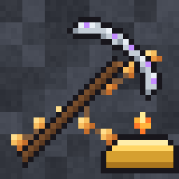

<p align="center"></p>

# Vein Miner & Ore Smelter

Two pickaxe enchantments for **Minecraft: Bedrock Edition 26.60 and newer** (built and checked against 26.63, the
current stable release):

- **Vein Miner** mines the whole connected vein of the ore you break.
- **Ore Smelter** smelts raw iron, raw copper, raw gold and ancient debris as they drop.

You find them as enchanted books in structure chests and put them on a pickaxe at an ordinary anvil. Nothing
else is added: no new blocks, no custom enchanting table, no recipes. The add-on runs on the stable Script
API (`@minecraft/server` 2.11.0, `@minecraft/server-ui` 2.3.0) and needs no experimental toggles.

Download: `dist/VeinMinerOreSmelter-1.0.0.mcaddon` (open it with Minecraft; it imports both packs).

## Finding the books

The books come from the chests of 15 structure loot tables: mineshafts, ancient cities, bastion remnants,
desert and jungle pyramids, monster rooms, pillager outposts, dungeons, stronghold corridors, crossings and
libraries, trial chamber vaults (normal and ominous), big ocean ruins and woodland mansions. That is every
structure whose vanilla chests can hold an enchanted book.

Each of those tables already has an enchanted book entry. The new books share that entry with the vanilla
book (normally 1 in 12 of those books is a Vein Miner book and 1 in 12 an Ore Smelter book), so:

- a chest gives books exactly as often as in vanilla, with no extra rolls;
- every other item keeps exactly its vanilla chance;
- signature books (Swift Sneak in ancient cities, Wind Burst in ominous vaults) are untouched.

The full table, with the chance per structure, is in [docs/loot-coverage.md](docs/loot-coverage.md). It is
generated from Mojang's files, and a check proves that each shipped table equals vanilla except for that one
entry.

The books look like vanilla enchanted books, glint and all, and show their enchantment in gray under the name.
They do not stack (like vanilla enchanted books), so they can never merge and lose anything, and they fit
in chiseled bookshelves.

## Putting a book on a pickaxe

1. Carry the pickaxe you want to enchant anywhere in your inventory.
2. Hold the book and use an anvil.
3. Pick the pickaxe from the list, check the cost and confirm.

The vanilla anvil screen only understands vanilla enchantments, so the book opens this small menu instead.
Nothing is used until you confirm. At that moment everything is checked again: the anvil is still there and
within reach, the book is still in the same slot, the pickaxe is exactly the one you picked, and you have the
levels. Closing the menu, leaving the game, moving an item or walking away costs nothing.

| | Cost |
|---|---|
| Vein Miner | 4 levels (priced like a Silk Touch book) |
| Ore Smelter | 2 levels (priced like a Fortune or Mending book) |
| Each earlier use of this menu on the same pickaxe | + the vanilla prior work penalty (1, 3, 7...) |

Creative mode applies books for free. As with vanilla anvils, each use in Survival has a 12% chance to damage
the anvil one stage (anvil, chipped, damaged, gone).

Both enchantments go on any pickaxe, including pickaxes from other add-ons (anything with the
`minecraft:is_pickaxe` tag), and both can be on the same pickaxe together with any vanilla enchantment. They
have a single level, like Silk Touch and Mending.

## Vein Miner

Break an ore by hand and the rest of its vein is mined too. **Sneak to break a single block.**

- **What counts as one vein:** ore blocks of the same kind that touch by a face, an edge or a corner. That
  covers diagonal steps on the same level, diagonal steps up and down, and branching veins. Regular and
  deepslate versions of an ore join up, and so do lit and unlit redstone ore. Anything else, including a
  different ore, stops the vein.
- **Ores:** coal, iron, copper, gold, redstone, lapis lazuli, diamond, emerald (all with their deepslate
  versions), nether quartz, nether gold and ancient debris.
- **Size limit:** 64 blocks by default, counting the block you break, nearest blocks first, and never more
  than 16 blocks away on any axis. The world owner can set the limit from 8 to 128 (see Settings).
- **Drops** are exactly what vanilla would give for each block with your pickaxe: Fortune at any level,
  Silk Touch (the ore block itself, regular or deepslate), and tool tier all come from the game itself. A
  pickaxe that cannot harvest an ore does not vein mine it. All drops from the vein appear where you broke
  the first block, so none end up sealed in a pocket you cannot reach.
- **Durability** works like mining each block by hand: one point per block, with Unbreaking's chance to save
  it (at any level). The first block is charged by the game as usual and never twice. When the next block
  would take the pickaxe's last point, the vein stops before that block, and you get a message. The pickaxe
  never breaks during a vein, and a block is only removed once its drops and cost are settled. Unbreakable
  pickaxes take no damage.
- **Experience:** each block drops its vanilla XP as separate orbs (none with Silk Touch), so Mending on the
  pickaxe and on armor repairs from it exactly as from ordinary mining.
- **Hunger:** each extra block adds the vanilla mining exhaustion.
- **Safety:** the block under any player standing on the vein is left in place, so nobody falls into a pit or
  lava. Blocks in chunks that are not loaded are never touched.
- **Game modes:** Survival as described. In Creative the vein breaks like Creative breaks blocks: no drops,
  no XP, no wear. In Adventure only blocks your pickaxe is allowed to destroy are mined. The `doTileDrops`
  game rule is respected.

## Ore Smelter

- Raw iron becomes an iron ingot, raw copper a copper ingot, raw gold a gold ingot, and ancient debris
  netherite scrap. Every raw item becomes exactly one smelted item, so Fortune's extra drops are smelted in
  full.
- It smelts only the drops of the blocks you mine: the block you break, plus the vein with Vein Miner.
  Items already on the ground, items other players drop, and items from any other block are never touched.
- You get the experience a furnace would give for the same smelting (0.7 per iron or copper ingot, 1 per
  gold ingot, 2 per netherite scrap, fractions rounded the furnace way), as orbs.
- **Silk Touch wins:** with Silk Touch the ore block drops whole and nothing is smelted.
- Nether gold ore drops nuggets, which do not smelt, so it is left as is.

## Grindstones, anvils, smithing and everything else

Bedrock has no custom enchantments, so the add-on records them on the pickaxe itself, twice: as item data
(which is saved with the item through chests, hoppers, dropping, death, world reloads and Realm restarts) and
as the gray lore line in the tooltip. If either record goes missing, the add-on restores it from the other the
next time the pickaxe is in a player's inventory. Renaming the pickaxe, custom names and other lore are kept.

- **Grindstone:** removes Vein Miner and Ore Smelter along with the vanilla enchantments, and resets their
  anvil cost.
- **Vanilla anvil:** repairing and renaming build the result from the left item, so both enchantments stay.
  When two pickaxes are combined, only the pickaxe on the **left** keeps them; the game does not know about
  the right one's. A tip says so the first time you open an anvil while carrying them.
- **Smithing table:** the netherite upgrade is built from the diamond pickaxe, so the records carry over.
  Either record alone is enough, and the other is then restored.

## Settings

Settings > Behavior Packs > Vein Miner & Ore Smelter > gear icon:

- **Vein size limit (blocks):** 8 to 128, default 64, counting the block you break.

## Compatibility

- Minecraft: Bedrock Edition 26.60 or newer. No experiments.
- Works in single player, multiplayer, on Realms and dedicated servers. All state is per player and per
  vein; nothing is shared between players, and nothing runs on a timer when nobody mines.
- The add-on replaces 15 vanilla chest loot tables (Bedrock cannot add to a loot table, only replace it).
  Another pack that replaces one of the same tables wins or loses depending on pack order, and only one of
  them applies. The tables are listed in [docs/loot-coverage.md](docs/loot-coverage.md).

## Limits of what the game allows

These come from the game, not from choices made here:

- **No custom enchantments in Bedrock.** The anvil menu replaces the vanilla anvil screen only for these
  books. The vanilla anvil's own prior work counter is not visible to scripts, so the cost counts only uses of
  this menu, and applying a book does not raise the vanilla counter.
- **Grindstone detection is inferred.** Scripts cannot see the grindstone screen. When you open a grindstone,
  the add-on notes the wear of the enchanted pickaxes you carry. A pickaxe that comes back with its vanilla
  enchantments gone, or repaired, counts as ground. A pickaxe that goes in and comes back unchanged keeps its
  enchantments. The check ends when you use another block or after 5 minutes.
- **An enchanting table can still enchant a pickaxe that only has these enchantments,** because the game does
  not count them as enchantments.
- **Vein blocks are removed by the script, not by the player.** Other add-ons that protect areas by
  cancelling a player's block breaking only see the first block, and vein blocks show no break particles
  (they do play the break sound).
- **Books only come from structures.** Fishing, raids, piglin bartering and librarian trades give vanilla
  books only (trades cannot hold custom items).
- **The Creative inventory** lists the two books as "Enchanted Book" without the gray line; the line appears
  as soon as the book is in your inventory.
- **Future vanilla versions:** if Mojang changes one of the 15 loot tables, the add-on needs an update that
  regenerates it (one command, below). The 26.70 preview already adds an item to the ancient city table.
- **Text** is in English (en_US); the strings are in `VeinMinerOreSmelter_RP/texts/en_US.lang` for anyone who
  wants to translate.

## What has been checked, and what still needs a check in game

The add-on could not be run inside Minecraft while it was being built. What is verified:

- every manifest, setting and item file validates against Mojang's own JSON schemas for 26.60;
- the 15 loot tables are proven equal to Mojang's 26.60 files except for the one shared book entry;
- 106 automated tests run the real add-on code against a stand-in for the game API: vein shapes and limits,
  Fortune and Silk Touch, durability and Unbreaking at the last points, XP, both game modes, unloaded chunks,
  players standing on veins, two players on one vein, Ore Smelter's item matching, every anvil failure path,
  lore limits and the grindstone check;
- the shipped script is exactly the build of the source.

What only a running game can confirm, and is worth a quick test after installing:

- that `generateLootFromBlock` gives Fortune drops for ores exactly as hand mining does (the API documents it
  as "as if it had been mined");
- that the first block's drops spawn inside the block's own space, where Ore Smelter looks for them;
- that the vanilla anvil, the grindstone and the smithing table copy item data and lore as described above;
- that the books appear under Enchanted Books in the Creative inventory.

## Design notes

These enchantments are inspired by the Vein Miner and Ore Smelter enchantments of the Better on Bedrock
add-on. None of its code or assets are used. Problems known from those versions were treated as things to
design out:

| Problem | How it is handled here |
|---|---|
| Smelting nearby items: scanning around the block also took other players' items or a pile already lying there, and could overwrite whole stacks | Only items that appear inside the broken block's own space, during that break, are smelted; vein drops are smelted before they are spawned |
| Experience counted per block with one shared global value for all players | Each vein keeps its own count; XP is the vanilla mining XP per block and furnace XP per smelted item |
| Writing back a copy of the pickaxe taken before the break (undoing durability or other changes) | The pickaxe is read after the game charged the first block, compared with the game's own "item after break", and only its durability is changed, in the same tick |
| Phantom drops and broken tools at low durability | The vein stops before a block that would cost the last point; a block is removed only after its drops and cost are settled |
| Unclear limits and off-by-one counts | The limit counts the first block; tests check exact counts on both sides of the limit |
| Fortune and Silk Touch handled by hand | Drops come from the game's own loot logic with the actual pickaxe |

More detail on how each part works is in [docs/DESIGN.md](docs/DESIGN.md).

## Building from source

Requires Node.js 22.12+ and Python 3 with `jsonschema`, `referencing` and `Pillow`, plus a checkout of
[Mojang/bedrock-samples](https://github.com/Mojang/bedrock-samples) for the schemas and vanilla loot tables.

```sh
npm install
npm run check      # TypeScript, strict
npm test           # 106 tests: rules, the game code against a stand-in API, and data consistency
npm run build      # src/ -> VeinMinerOreSmelter_BP/scripts/main.js
npm run loot -- --check
python3 tools/validate.py --samples ../bedrock-samples
npm run package    # dist/VeinMinerOreSmelter-<version>.mcaddon
```

To regenerate the loot tables for a new game version:

```sh
python3 tools/loot.py --from ../bedrock-samples/behavior_pack
```

| Folder | Contents |
|---|---|
| `src/rules/` | Pure rules (no game API): ores, vein search, wear, XP, stacks, anvil prices, grindstone check |
| `src/game/` | The game side: vein mining, Ore Smelter, the anvil menu, record upkeep, settings |
| `tests/` | Unit and integration tests; `tests/fake/` is a small stand-in for the game API |
| `tools/` | Script build, loot table generator and check, schema validator, icon, packager |
| `VeinMinerOreSmelter_BP/`, `VeinMinerOreSmelter_RP/` | The packs as shipped |

## Notices

Not an official Minecraft product. Not approved by or associated with Mojang or Microsoft. Not affiliated
with the authors of Better on Bedrock. The book icon uses the game's own enchanted book texture by reference;
the 15 loot tables are Mojang's vanilla tables with the one entry described above changed, as every add-on
that changes loot must ship them.
